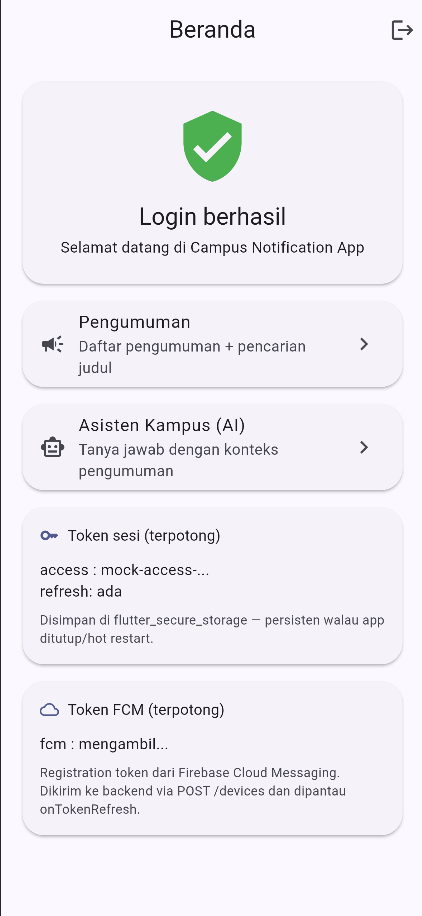
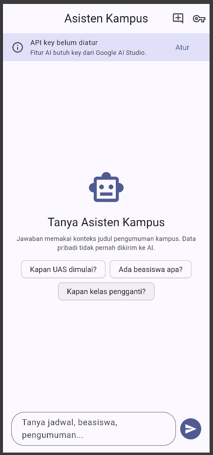
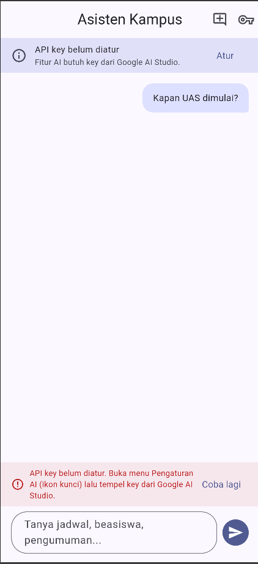
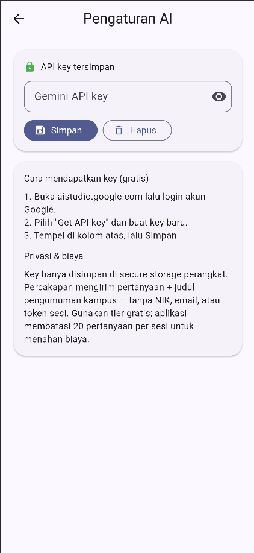

# Week 10 — AI Feature Integration: Chat Asisten Kampus (Gemini)

Minggu 10 menambah **satu fitur AI** pada aplikasi
`_07_week_7_clean_architecture` (campus_notify): **chat asisten kampus**
berbasis Google Gemini API. Aplikasi yang dinilai tetap
`_07_week_7_clean_architecture`; folder ini berisi dokumentasi dan bukti
proses integrasinya (pola yang sama dengan Minggu 9).

Kebijakan AI codelab diikuti: AI boleh membantu merancang dan mengimplementasi
fitur AI, tetapi setiap baris dibaca, diverifikasi, diuji, di-refactor, dan
keputusannya dijelaskan. Bukti verifikasi ada di
[docs/ai-log.md](docs/ai-log.md).

## Identitas

| | |
| --- | --- |
| Nama | Muhammad Zuhdi Yudadharma |
| NIM | 244107020017 |
| Kelas | TI-3H |
| Repository | `Zuhdiaja/244107020017-mobile-course` |
| Project | `_07_week_7_clean_architecture` (campus_notify) |
| Branch fitur | `feat/ai-assistant` dari `develop` |

## Fitur: chat asisten kampus

| Aspek | Isi |
| --- | --- |
| Rute | `/asisten` (chat) dan `/asisten/pengaturan` (API key) |
| API | Google Generative Language API v1beta — `POST models/{model}:generateContent`, model `gemini-flash-latest` |
| API key | Masukan pengguna via halaman Pengaturan AI, disimpan di `flutter_secure_storage` — tidak pernah di-hardcode (grep `AIza` di `lib/` → nol hasil) |
| Prompt | system prompt (persona + batas) + konteks maksimal 5 judul pengumuman lokal + pertanyaan pengguna; `maxOutputTokens: 200` |
| Arsitektur | feature-first Minggu 7: `domain/` (entity, kontrak repository, use case) → `data/` (client Dio, store, impl) → `presentation/` (pages, providers Riverpod) |
| Konteks lokal | judul + tanggal pengumuman dari fitur `announcements` — **tanpa** NIK/email/token |
| Error handling | DioException dipetakan ke `Failure` berbahasa Indonesia: timeout, koneksi, 400/401/403 (key tidak valid), 429 (kuota), 5xx |
| Fallback | banner error inline + tombol "Coba lagi" + arah ke pencarian pengumuman lokal (fitur Minggu 9); API key kosong → banner "Atur" |
| Mitigasi biaya | batas 20 pertanyaan/sesi, maks 500 karakter/pertanyaan, 5 baris konteks, jawaban maks ~200 token |

### Struktur file baru

```text
lib/features/assistant/
├── domain/
│   ├── entities/assistant_message.dart
│   ├── repositories/assistant_repository.dart
│   └── usecases/ask_assistant.dart
├── data/
│   ├── datasources/
│   │   ├── gemini_api_client.dart
│   │   ├── api_key_store.dart
│   │   └── assistant_api_errors.dart
│   ├── models/gemini_response_model.dart
│   └── repositories/assistant_repository_impl.dart
└── presentation/
    ├── pages/assistant_page.dart
    ├── pages/api_key_page.dart
    └── providers/assistant_providers.dart
```

Perubahan kecil: rute baru di `routes.dart` + `main.dart`, kartu pintu masuk
di `home_page.dart`, `ValueKey` untuk uji drive Chrome.

## Cara menjalankan

```bash
cd _07_week_7_clean_architecture
flutter pub get
# credential Firebase untuk fitur Minggu 6 (android/app/google-services.json)
flutter run -d chrome
```

Alur uji di Chrome (login mock `budi@polinema.ac.id` / sandi bebas >= 6):

1. Beranda → kartu **Asisten Kampus (AI)**.
2. Tanpa API key: banner "API key belum diatur" tampil; kirim pertanyaan →
   pesan ramah + tombol "Coba lagi" (fallback, bukan crash).
3. Ikon kunci → Pengaturan AI → tempel key dari
   [aistudio.google.com](https://aistudio.google.com) → Simpan.
4. Kembali ke chat → tanya "Kapan UAS dimulai?" → jawaban Gemini maksimal
   2 kalimat merujuk konteks pengumuman.

## Hasil yang dicapai

- 1 fitur AI (chat asisten Gemini) terintegrasi mengikuti Clean Architecture:
  domain bebas framework, presentation hanya membaca provider.
- 22 test baru (5 unit use case, 3 model, 6 repository, 8 widget) tanpa
  merusak 40 test lama — total 62 test.
- Privasi: API key di secure storage, prompt hanya membawa judul pengumuman,
  system prompt melarang membocorkan data pribadi.
- 3 cacat pada output awal AI terbukti oleh mesin (`valueOrNull` Riverpod 3,
  3 lint `prefer_initializing_formals`, parameter fake tak terpakai) —
  lihat [docs/ai-log.md §3](docs/ai-log.md#3-output-awal-ai-kode-yang-diusulkan-dan-cacatnya).

## Bukti mesin hijau

Dijalankan lokal di branch `feat/ai-assistant` dan diulang otomatis oleh CI
saat PR ke `develop`:

```text
dart format --set-exit-if-changed lib test   -> 0 changed
flutter analyze                              -> No issues found!
flutter test                                 -> 62 tests passed
```

## Tabel risiko dan mitigasi

| Risiko | Mitigasi di aplikasi |
| --- | --- |
| Bocor data pengguna | Hanya judul + tanggal pengumuman yang dikirim; API key/token sesi tidak pernah masuk prompt; system prompt melarang menampilkan data pribadi; key bisa dihapus dari UI |
| Biaya melonjak | Tier gratis Gemini; batas 20 pertanyaan/sesi di use case; maks 500 karakter; 5 baris konteks; `maxOutputTokens: 200` |
| API error / down | Timeout 15/30 detik; `Failure` ramah per kode (429, 5xx, koneksi); banner inline + "Coba lagi"; fallback ke pencarian pengumuman lokal |
| Respons tidak relevan / mengarang | System prompt: "jika informasinya tidak ada, katakan tidak tahu"; jawaban dibatasi 2 kalimat; pengguna diarahkan ke portal akademik |
| Model free-tier berubah | Nama model jadi argumen repository (default konstanta), ganti tanpa menyentuh domain |
| Key tertinggal di perangkat | Key disimpan secure storage; halaman Pengaturan menyediakan tombol "Hapus" |

## Bukti visual

Uji manual dijalankan di **Chrome (`flutter run -d chrome`)** melalui
`flutter drive` — sesi emulator di mesin ini tidak stabil, dan fitur
chat bebas Firebase sehingga perilakunya identik di web maupun Android.
Uji ini membuktikan **fallback design**: semua layar bisa dipakai tanpa
API key tanpa crash.



Beranda: kartu pintu masuk fitur AI di bawah kartu Pengumuman.



Halaman chat: empty state "Tanya Asisten Kampus" + saran pertanyaan, dengan
banner ramah "API key belum diatur" dan tombol **Atur** menuju pengaturan.



Kirim pertanyaan tanpa key: gelembung pertanyaan tetap tercatat, muncul
banner "API key belum diatur. Buka menu Pengaturan AI..." + tombol
**Coba lagi** — bukti mitigasi risiko "API error/down" dari tabel risiko.



Halaman Pengaturan AI: tempel key Gemini, simpan ke secure storage,
hapus bila perlu — key tidak pernah tampil utuh setelah tersimpan.

## Dokumentasi

- [docs/ai-log.md](docs/ai-log.md) — prompt tugas, system/user prompt,
  output awal AI + 3 cacatnya, verifikasi 6 langkah, tabel keputusan,
  bukti mesin hijau, refleksi
- [screenshots/](screenshots/) — bukti visual alur Chrome
