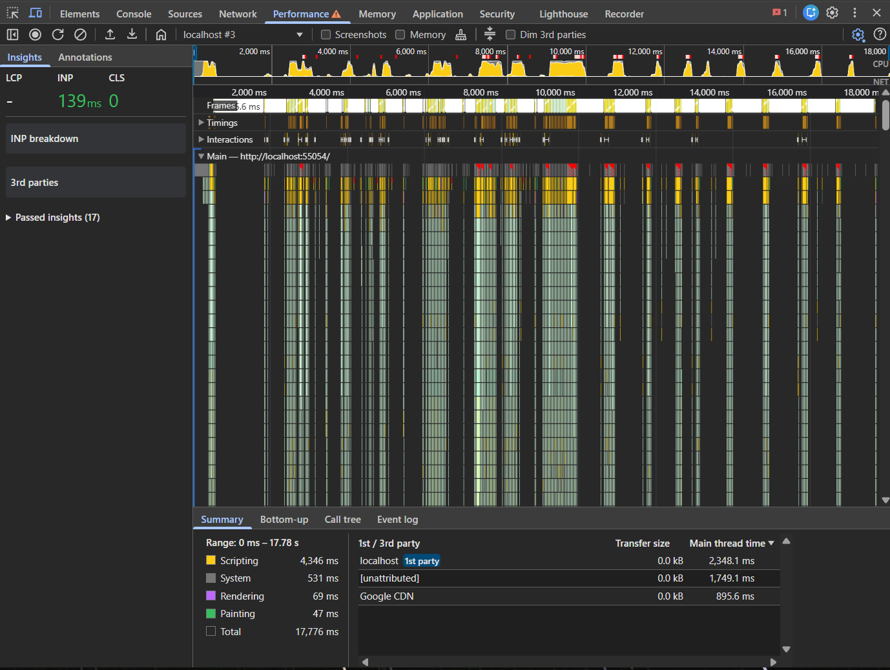

# Week 11: Performance Optimization

Optimasi performa project Minggu 7-10 (`campus_notify`) tanpa mengubah
perilaku aplikasi. Yang diubah adalah jumlah kerja yang dilakukan Flutter
untuk hal yang sama: rebuild widget, parsing data, dan pembentukan konteks AI.

Temuan lengkap ada di [docs/performance-findings.md](docs/performance-findings.md),
laporan metrik dan verifikasi ada di [docs/performance-report.md](docs/performance-report.md).

## Identitas

| | |
| --- | --- |
| Nama | Muhammad Zuhdi Yudadharma |
| NIM | 244107020017 |
| Kelas | TI-3H |

## Ringkasan hasil

| Metrik | Sebelum | Sesudah |
| --- | --- | --- |
| Parsing payload saat `fetchAll()` | 5 map JSON tiap panggilan | 1x, sisanya dari cache |
| Recompute filter saat mengetik "ujian" | 5x | 1x |
| Rebuild halaman chat per perubahan state | seluruh `Scaffold` | hanya zona terkait |
| Widget statis beranda | ikut rebuild | `const`, dilewati Flutter |
| Frame terlama (profile, web) | tidak direkam | 86,6 ms |
| `flutter analyze` | bersih | bersih |
| `flutter test` | 63 lulus | 69 lulus |



## Optimasi yang diterapkan

| # | Teknik | Lokasi | Alasan |
| --- | --- | --- | --- |
| 1 | Debounce input pencarian 250 ms | `SearchQueryNotifier` | Memotong 5 recompute filter menjadi 1 per kata |
| 2 | Cache-first di repository | `AnnouncementRepositoryImpl` | Parsing JSON hanya sekali, kontrak domain tetap |
| 3 | Pemecahan zona rebuild + `select` | `assistant_page.dart` | Perubahan kecil tidak membangun ulang seluruh halaman |
| 4 | Widget `const` + `select` | `home_page.dart`, `announcements_page.dart` | Widget statis tidak pernah rebuild |
| 5 | `RepaintBoundary` pada item list | Halaman pengumuman, chat | Isolasi repaint per item |

Teknik yang **tidak** diterapkan beserta alasannya:

| Teknik | Alasan tidak dipakai |
| --- | --- |
| Pagination / infinite scroll | Data pengumuman hanya 5 item, belum ada endpoint berpaginasi |
| `CachedNetworkImage` | Aplikasi belum menampilkan gambar jaringan |
| Dio cache interceptor | Sumber data masih lokal, belum ada remote data source |

Menambahkan ketiganya sekarang hanya menambah kode tanpa masalah yang
diselesaikan. Sesuai codelab, optimasi dilakukan setelah ada bukti masalah.

## Bukti verifikasi

Selain profiling, optimasi dibuktikan lewat test yang bisa gagal bila
perbaikan rusak:

| Test | Yang dibuktikan |
| --- | --- |
| `test/announcement_repository_cache_test.dart` | `parseRuns` tetap 1 setelah dua kali `fetchAll()`; instance daftar identik |
| `test/search_debounce_test.dart` | 5 ketikan beruntun menghasilkan 1 pembaruan state; `clear()` tetap instan |

Perbaikan diklaim berdasarkan angka ini, bukan berdasarkan "kode terlihat
lebih rapi". Penjelasan lengkap ada di bagian verifikasi laporan.

## Fitur utama

| Fitur | Isi |
| --- | --- |
| `auth` | Login, sesi, penyimpanan access/refresh token di secure storage, logout, refresh token otomatis `401`. |
| `notifications` | Permission, token lifecycle FCM, tiga app state (foreground, background, terminated), deep link. |
| `announcements` | Daftar pengumuman + pencarian judul, deep link `/pengumuman/:id`. |
| `assistant` | Chat asisten kampus berbasis AI dengan konteks judul pengumuman. |

## Stack

| | |
| --- | --- |
| Language | Dart 3.13.4 |
| Framework | Flutter 3.47.5 |
| State | Riverpod 3.4.3 |
| Routing | GoRouter |
| Jaringan | Dio |
| Penyimpanan | flutter_secure_storage |
| Notifikasi | firebase_messaging + flutter_local_notifications |
| Backend | Firebase (email/password auth) |

## Cara menjalankan

Butuh Flutter SDK dan Android SDK. Device HP juga bisa dipakai langsung
lewat USB debugging.

```bash
flutter pub get

# isi credential Firebase dulu
# android/app/google-services.json
# service-account.json  (tidak di-commit, sudah masuk .gitignore)

flutter run
```

Untuk profiling, jalankan mode profile (bukan debug, bukan release):

```bash
flutter run -d chrome --profile
```

Lalu di Chrome DevTools, tab Performance, set `CPU: 4x slowdown` dan matikan
opsi Screenshots sebelum merekam. Mode `--debug` menambah overhead sehingga
frame time tidak mewakili performa nyata; mode `--release` tidak menyediakan
instrumentasi profiling.

Untuk pengujian:

```bash
flutter analyze
flutter test
```

Hasil akhir:

```text
flutter analyze    No issues found!
flutter test       69 tests passed
```

## Struktur

```text
lib/
├── core/
│   ├── failures.dart
│   └── format.dart
├── features/
│   ├── auth/
│   │   ├── domain/
│   │   ├── data/
│   │   └── presentation/
│   ├── announcements/
│   │   ├── domain/
│   │   ├── data/
│   │   └── presentation/
│   ├── assistant/
│   │   ├── domain/
│   │   ├── data/
│   │   └── presentation/
│   └── notifications/
│       ├── data/push_service.dart
│       └── presentation/providers/notifications_providers.dart
├── pages/home_page.dart
├── routes.dart
└── main.dart
```

## Arah dependensi

```text
presentation  ->  domain  <-  data
```

Domain tidak mengimpor apa pun dari Flutter, Dio, atau Firebase, jadi logika
bisnisnya bisa diuji tanpa device. Optimasi Minggu 11 seluruhnya berada di
lapisan `data` (cache repository) dan `presentation` (rebuild widget), tidak
menyentuh `domain`.

## Catatan keterbatasan

Profiling dilakukan di Flutter web, sehingga tidak ada track UI Thread dan
Raster Thread terpisah seperti di Android. Screenshot yang tersedia hanya
kondisi sesudah optimasi, jadi angka baseline diambil dari analisis kode, bukan
dari frame chart. Data uji juga hanya 5 item sehingga selisih frame time antar
versi kecil. Bukti dampak utama karena itu ada pada instrumen kode dan test
otomatis.

## Dokumentasi

- [docs/performance-findings.md](docs/performance-findings.md) - temuan per masalah
- [docs/performance-report.md](docs/performance-report.md) - metrik, optimasi, verifikasi, refleksi
- [docs/ai-challenge.md](docs/ai-challenge.md) - catatan AI Challenge Minggu 7

Screenshot:

- `screenshots/after-profile.png` - Chrome DevTools Performance, sesudah optimasi
- `screenshots/week11-home.png` - beranda aplikasi
