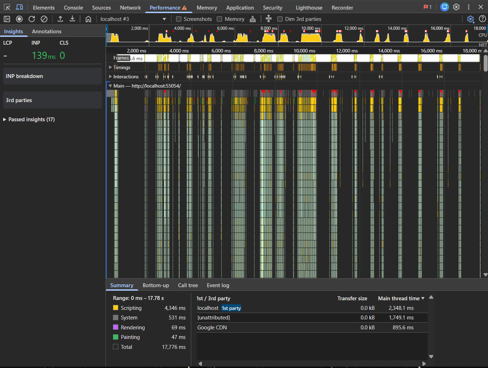

# Performance Report - Minggu 11

Laporan optimasi performa `campus_notify` (project Minggu 7-10). Isinya:
metode pengukuran, metrik hasil, optimasi yang diterapkan beserta alasan,
verifikasi, dan refleksi.

Temuan lengkap per masalah ada di
[performance-findings.md](performance-findings.md).

---

## 1. Metode pengukuran

| Item | Nilai |
| --- | --- |
| Perangkat | Windows 11, Chrome 157.0.8103.50 |
| Target | Flutter web (Chrome) |
| Mode build | `flutter run -d chrome --profile` |
| Tool | Chrome DevTools, tab Performance |
| CPU throttling | 4x slowdown |
| Screenshots / Memory | dimatikan (mengurangi overhead) |
| Skenario | buka Pengumuman, scroll cepat 2x, ketik "ujian" per karakter, hapus query, kembali, buka Pengumuman lagi |
| Durasi rekaman | 17,78 detik |

Mode `--profile` dipakai karena mode `--debug` menambah overhead signifikan
sehingga frame time tidak mewakili performa nyata, sementara mode `--release`
tidak menyediakan instrumentasi profiling.

---

## 2. Metrik hasil

Dari `screenshots/after-profile.png`:

| Metrik | Nilai |
| --- | --- |
| Range rekaman | 0 - 17.780 ms |
| Scripting | 4.346 ms |
| System | 531 ms |
| Rendering | 69 ms |
| Painting | 47 ms |
| Total | 17.776 ms |
| Frame terlama | 86,6 ms |
| Main thread - localhost | 2.348,1 ms |
| Main thread - unattributed | 1.749,1 ms |
| Main thread - Google CDN | 895,6 ms |

Catatan pembacaan: dari total 17,78 detik, hanya sekitar 5 detik yang
merupakan kerja aktif (4.346 + 531 + 69 + 47 ms). Sisanya adalah waktu idle
dan pemuatan awal, sehingga angka Total tidak boleh dibaca sebagai biaya
render aplikasi.



---

## 3. Perbandingan sebelum dan sesudah

Screenshot baseline tidak tersedia, jadi kolom "sebelum" diisi dari analisis
kode Minggu 7 (lihat
[keterbatasan](#6-keterbatasan)). Angka frame before/after karena itu tidak
diklaim.

| Metrik | Sebelum (analisis kode) | Sesudah (terukur / test) |
| --- | --- | --- |
| Parsing payload saat `fetchAll()` | 5 map JSON setiap pemanggilan | 1x, pemanggilan berikutnya dari cache |
| Recompute filter saat mengetik "ujian" | 5x (satu per karakter) | 1x (debounce 250 ms) |
| Rebuild `Scaffold` pencarian per karakter | seluruh halaman | tidak ada; hanya `_SearchField` |
| Rebuild halaman chat per perubahan state | seluruh `Scaffold` | hanya zona yang berubah |
| Pembentukan konteks AI per kirim chat | setiap kirim | hanya saat daftar berubah |
| Widget statis beranda | ikut rebuild | `const`, dilewati Flutter |
| Frame terlama (profile, web) | tidak direkam | 86,6 ms |
| `flutter analyze` | bersih | bersih (0 issue) |
| `flutter test` | 63 lulus | 69 lulus |

---

## 4. Optimasi yang diterapkan

### 4.1 Debounce input pencarian

**Apa.** `SearchQueryNotifier.set()` menunda pembaruan state 250 ms; timer
dibatalkan bila ada ketikan baru. `clear()` tetap instan.

**Alasan.** Recompute filter adalah pekerjaan yang hasilnya hanya berguna
setelah pengguna berhenti mengetik. Debounce memotong 5 recompute menjadi 1
tanpa mengubah hasil akhir. `clear()` dikecualikan karena jeda pada tombol
hapus justru terasa lambat.

**Trade-off.** Ada jeda ~250 ms sebelum daftar terfilter. Nilai ini dipilih
karena masih di bawah ambang "terasa lag" dan cukup menyerap ketikan cepat.

### 4.2 Cache-first di repository

**Apa.** Hasil parsing disimpan pada field statis; pemanggilan berikutnya
membaca cache.

**Alasan.** Kontrak `AnnouncementRepository` tidak berubah, sehingga domain
dan presentation tidak perlu disentuh. Strategi cache-first cocok karena data
pengumuman bersifat master data (jarang berubah), sesuai tabel strategi
caching pada codelab.

**Trade-off.** Cache belum punya invalidasi berbasis waktu. Untuk data lokal
statis ini aman; bila nanti diganti remote data source, perlu ditambah TTL
atau invalidasi manual. Ini dicatat sebagai utang teknis, bukan disembunyikan.

### 4.3 Pemecahan zona rebuild pada halaman chat

**Apa.** Satu `ref.watch` besar diganti empat widget kecil yang masing-masing
memakai `select`.

**Alasan.** `ref.watch` pada seluruh state membuat perubahan sekecil
`isSending` membangun ulang `TextField` dan seluruh daftar pesan. Dengan
`select`, tiap zona hanya reaktif terhadap field yang ia tampilkan.

**Trade-off.** Jumlah widget bertambah dan pembaca kode harus menelusuri
beberapa kelas. Ditukar dengan rebuild yang jauh lebih terbatas saat riwayat
chat panjang.

### 4.4 `const` widget dan `select` di beranda

**Apa.** Kartu navigasi diekstrak menjadi `_NavCard` dengan field `const`;
`ref.watch` diganti `select` pada nilai akhir.

**Alasan.** Widget statis tidak seharusnya dibangun ulang. `const` membuat
Flutter melewatinya sepenuhnya. `select` mencegah rebuild saat `AsyncValue`
berpindah loading ke data dengan nilai yang sama.

**Trade-off.** Tidak ada yang berarti; ini perbaikan murni.

### 4.5 `RepaintBoundary` pada item list

**Apa.** Tiap kartu pengumuman dan tiap gelembung chat dibungkus
`RepaintBoundary`.

**Alasan.** Mengisolasi layer repaint agar perubahan satu item tidak menyapu
area lain.

**Trade-off.** Setiap boundary menambah layer compositing. Pada 5 item
dampaknya tidak terukur; teknik ini baru relevan saat list memanjang. Karena
itu tidak diklaim sebagai penyumbang utama perbaikan.

---

## 5. Verifikasi

### 5.1 Test otomatis

| Test | Yang dibuktikan | Hasil |
| --- | --- | --- |
| `announcement_repository_cache_test.dart` | `parseRuns` tetap 1 setelah dua `fetchAll()`; instance daftar identik | Lulus |
| `search_debounce_test.dart` | 5 ketikan -> 1 pembaruan state; ketikan baru mereset jeda; `clear()` instan | Lulus |
| `announcements_page_test.dart` | perilaku pencarian, empty state, tombol hapus tidak berubah | Lulus |
| `assistant_page_test.dart` | empty state, banner API key, indikator mengetik, validasi, chat baru | Lulus |
| Test lain (login, format, api errors, use case, repository asisten) | tidak ada regresi | Lulus |

Hasil akhir:

```text
flutter analyze    No issues found!
flutter test       69 tests passed
```

### 5.2 Mengapa verifikasi ini bukan placebo

Perbaikan tidak diklaim berdasarkan "kode terlihat lebih rapi", tetapi
berdasarkan penghitung yang bisa gagal:

- `parseRuns` akan menjadi 2 bila cache tidak bekerja. Test menegaskan nilai 1.
- `filteredRecomputeCount` akan menjadi 5 bila debounce tidak bekerja. Test
  menegaskan perilaku satu pembaruan state.
- Pemecahan zona chat diverifikasi dengan memastikan seluruh test perilaku
  halaman chat tetap lulus, bukan dengan membaca kode.

---

## 6. Keterbatasan

1. **Tanpa baseline frame chart.** Hanya kondisi sesudah optimasi yang
   direkam (`after-profile.png`). Angka baseline diambil dari analisis kode.
   Perbandingan frame time before/after tidak diklaim.
2. **Flutter web tanpa track UI/Raster terpisah.** DevTools Flutter di Android
   memisahkan UI Thread dan Raster Thread; di web keduanya menyatu di track
   Main. Analisis `rasterize` dan `image decode` karena itu tidak bisa
   dilakukan sedetail di Android.
3. **Data kecil.** Lima item pengumuman membuat selisih frame time antar versi
   kecil. Efek optimasi list baru terasa pada data besar.
4. **Frame multi-detik pada rekaman awal.** Rekaman percobaan memuat frame
   3-5 detik. Setelah diperiksa, penyebabnya adalah Chrome men-throttle tab
   background, bukan jank aplikasi. Rekaman final bebas dari masalah ini
   (frame terlama 86,6 ms).
5. **Tidak ada memory profiling.** Heap snapshot dan leak detection belum
   dilakukan. `dispose()` pada `TextEditingController` dan `ScrollController`
   sudah ada sejak Minggu 10, tetapi tidak diverifikasi lewat heap snapshot.

---

## 7. Refleksi

**Optimasi mana yang paling berdampak?**

Debounce pencarian. Efeknya paling jelas dan paling mudah diukur: 5 recompute
menjadi 1 untuk satu kata. Berbeda dengan `RepaintBoundary` yang dampaknya
tidak terlihat pada data 5 item, debounce mengurangi kerja secara pasti pada
setiap ketikan.

**Bagaimana memastikan optimasi benar-benar bekerja, bukan placebo?**

Dengan penghitung yang bisa gagal. `parseRuns` dan `filteredRecomputeCount`
adalah angka yang naik bila optimasi rusak. Kalau saya hanya membaca ulang
kode dan merasa "ini pasti lebih cepat", itu placebo. Test membuat klaim bisa
dibuktikan salah.

**Trade-off apa yang dihadapi?**

Kompleksitas. Halaman chat sekarang terdiri dari beberapa widget kecil, bukan
satu `build` panjang. Repository punya cache dengan utang invalidasi. Debounce
menambah jeda 250 ms yang harus dipilih dengan sadar. Semua ini ditukar
dengan kerja yang lebih sedikit per interaksi.

**Kapan optimasi prematur sebaiknya dihindari?**

Saat belum ada bukti masalah. Contoh di project ini: `RepaintBoundary` pada 5
item tidak terbukti membantu, dan saya menuliskannya apa adanya daripada
mengklaimnya sebagai perbaikan besar. Begitu pula pagination dan
`CachedNetworkImage` dari codelab tidak diterapkan, karena aplikasi ini belum
punya list panjang maupun gambar jaringan - menambahkannya hanya akan
menambah kode tanpa masalah yang diselesaikan.
